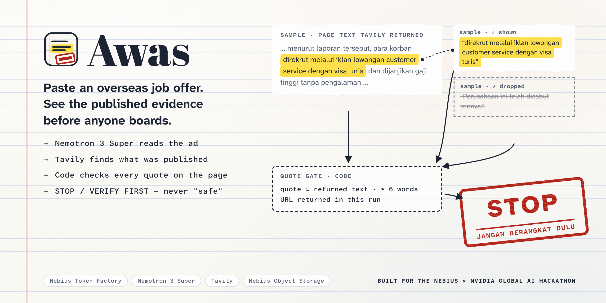
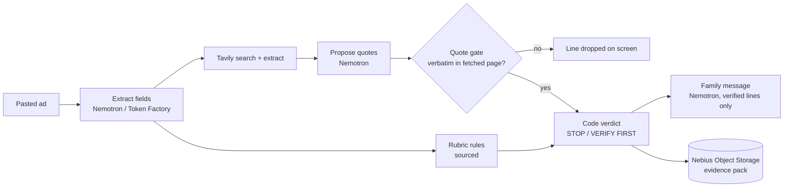

<div align="center">
  
  <h1>Awas 🚨</h1>
  <p><em>Paste an overseas job offer. Get an evidence file — every line a URL plus a quote that code checked against the page's text — and a STOP or VERIFY FIRST before anyone boards.</em></p>
  

  <br/>

  [](https://awas.edycu.dev)
  [](https://awas.edycu.dev/about)
  [](https://awas.edycu.dev/pitch)
  [](DEMO.md)
  [](FEEDBACK.md)
  [](https://nebiusglobalaihackathon.devpost.com/)

  <br/>

  
  
  
  
  
  
  [](https://opensource.org/licenses/MIT)

</div>

---

**Read first:** [`DEMO.md`](DEMO.md) (what was measured, and what was not) · [`FEEDBACK.md`](FEEDBACK.md) (feedback on the Nebius docs and API) · [`docs/SOURCES.md`](docs/SOURCES.md) (every rule and statistic, with the page and the verbatim sentence).

*Awas* is Indonesian for "watch out".

## 📸 See it in Action

**No credentials needed:** [`/judge`](https://awas.edycu.dev/judge) replays five recorded real runs — three STOPs on cited rules (one of them an English ad), a fake vacancy that borrowed a real company's name (VERIFY FIRST), a licensed agency's vacancy (NO RED FLAGS FOUND) — each labelled with its recording date ([`bench/samples.json`](bench/samples.json) says where each text comes from). Live checks need no login (60 per hour per connection). Run locally with the commands in [Getting Started](#-getting-started).

**Live:** [awas-cek.vercel.app](https://awas.edycu.dev) (the app) · [/about](https://awas.edycu.dev/about) (the story page, with the rules and the quote gate running in your browser) · [/pitch](https://awas.edycu.dev/pitch) (the deck).

> **Measured, out of sample** (tranche 2 of a benchmark frozen before it ran, run once on code tagged `code-freeze`, as a Nebius Serverless Job — [`DEMO.md`](DEMO.md)): **0 of 10 licensed agencies' vacancies stopped**; of 25 publicly reported scam-recruitment cases, **9 STOP, 15 VERIFY FIRST, 1 NO RED FLAGS FOUND**. Every one of the 48 evidence lines shown carries a URL and a quote the code found verbatim in the page text Tavily returned. One honest note first: our own day-0 gate on search coverage failed (a relevant item for 8 of 20 known cases), so Awas does not promise "published reports about this company" — the verdict comes from rules quoted from official pages, and the web evidence is context.

## 💡 The Problem & Solution

### The Problem

An aunt in a family WhatsApp group is forwarded an ad — "CS Kamboja, Rp 15 jt/bulan, visa turis OK, tiket ditanggung" — and must tell her nephew tonight whether to take it. The rules that would stop him exist — Cambodia is not a placement country, a tourist visa is not a work permit, a fee before a contract is a warning sign — but they are scattered across police, ministry and embassy pages, and nobody in the group can check them all before he decides. (A composite scene, not a single person.)

The scale is official: Indonesia's foreign ministry reports **1,301 cases handled by the embassy in Cambodia in Q1 2025, 85 % of them online scams**, and **more than 12,000 Indonesians affected between 2021 and 2025**. Each statistic is quoted verbatim with its page in [`docs/SOURCES.md`](docs/SOURCES.md).

### The Solution

> The scam checkers we looked at give a risk score. Awas gives no score, only evidence: every quote has a URL and is checked in code against the page's text, and lines that fail are dropped on screen.

1. **Extract** — Nemotron 3 Ultra on Nebius Token Factory copies typed fields (company, destination, job, visa, fees, promises, phones) out of the pasted ad; code checks every field is literally in the ad.
2. **Rubric** — fixed rules, each quoting an official page ([`src/lib/rule-sources.ts`](src/lib/rule-sources.ts), [`docs/SOURCES.md`](docs/SOURCES.md)): a job in Cambodia or Myanmar (not placement countries, KP2MI), a tourist or visit visa for work, a fee before a contract and a held passport are `NEVER` rules (STOP); the police checklist's fast departure, high pay for light work, costs advanced then deducted, no company named, and any fee are `CAUTION` (VERIFY FIRST). A named Indonesian company is looked up in a dated snapshot of the official licensed-agency (P3MI) list.
3. **Search** — Tavily looks for published pages naming this exact company or number, and for reporting on job scams to the same destination — context for the family, never an input to a rule.
4. **Propose** — the model proposes evidence lines `{url, quote, claim}` over the pages Tavily returned in this run.
5. **Quote gate** — code accepts a quote only if it is a normalised verbatim substring of a chunk fetched in this run. A line that fails is dropped, visibly. Anyone can re-check with [`scripts/verify_quotes.py`](scripts/verify_quotes.py).
6. **Verdict by code, not by model** — **STOP**, **VERIFY FIRST**, or **NO RED FLAGS FOUND** (explicitly "not a guarantee"; never "safe"), from the rubric flags, the verified lines and any failed step ([`src/lib/verdict.ts`](src/lib/verdict.ts)).
7. **Family message** — a short Bahasa message built only from verified lines, with a link to the source of each.

## 🏗️ Architecture & Tech Stack



| Layer | Choice |
|---|---|
| App | Next.js 15, TypeScript, Tailwind 4 |
| Models | NVIDIA Nemotron on Nebius Token Factory, routed per call: **Nemotron 3 Ultra** (`nvidia/Nemotron-3-Ultra-550b-a55b`) extracts the fields (84.8 % field accuracy on 25 Indonesian texts — 20 reporters' descriptions of scam offers and 5 licensed vacancies — vs Super 70.7 % and Lightning 59.6 %, against labels drafted by our build agent, not yet reviewed by a human: [`docs/proof/stage-t.json`](docs/proof/stage-t.json)); **Nemotron 3 Super** (`nvidia/nemotron-3-super-120b-a12b`) proposes evidence lines and writes the family message |
| Retrieval | Tavily `/search` and `/extract` |
| State | Nebius Object Storage (S3 API, SigV4): evidence packs (rewritten as each step completes), per-IP rate slots (conditional create); a 75-day expiry rule on `cases/` is intended, its receipt is pending |
| Nebius libraries | `src/lib/nebius/` (SigV4, Object Storage, service-account auth, Serverless Jobs), copied from the same author's earlier project, [faultline](https://github.com/edycutjong/faultline) |

## 🏆 Nebius Token Factory + NVIDIA Nemotron + Tavily Integration

| # | Sponsor method | What it does in the flow | Code |
|---|---|---|---|
| 1 | Nebius Token Factory `POST /v1/chat/completions`, Nemotron | up to three calls per case: extract fields; propose evidence lines; write the family message | [`tf.ts`](src/lib/tf.ts), [`extract.ts`](src/lib/extract.ts), [`propose.ts`](src/lib/propose.ts), [`message.ts`](src/lib/message.ts) |
| 2 | Tavily `POST /search` | exact-phrase search for the company and phone, a destination search for context, page text for the gate | [`tavily.ts`](src/lib/tavily.ts) |
| 3 | Tavily `POST /extract` | relevant passages from official advisory pages | [`tavily.ts`](src/lib/tavily.ts) |
| 4 | Nebius Object Storage `PutObject` / `GetObject`; conditional `PutObject` for rate slots; presigned URLs | evidence packs, per-IP rate slots, recorded samples, the bench job's results | [`storage.ts`](src/lib/nebius/storage.ts), [`store.ts`](src/lib/store.ts) |
| 5 | Nebius Serverless Jobs `POST /ai/v1/jobs` | runs the frozen benchmark on Nebius compute (uk-south1, `cpu-d3`): tranche 2 ran as job `aijob-e03nhcfcwc4vnee33m` ([`bench/results-t2-job.json`](bench/results-t2-job.json)); the job holds no Nebius or model-provider credential — only the app's bench secret and two presigned upload URLs | [`jobs.ts`](src/lib/nebius/jobs.ts), [`dispatch/route.ts`](src/app/api/bench/dispatch/route.ts) |

**Honest count: 5 distinct methods from 2 vendors**, with NVIDIA as the model family (Nemotron 3 Ultra and Super).

The one extension no sponsor ships is the **quote gate**: two generic APIs become an evidence standard a reader can re-check. The model reads the ad and proposes what to quote; code builds the searches, checks every quote and decides what is shown.

## 📊 Engineering Rigor

| Metric | Value |
|---|---|
| Unit tests | **144 passing** (`npm test`, 12 files) |
| Browser tests | **56 passing** (`npm run e2e`: 28 checks × phone and desktop projects; credential-free paths only: home, `/judge`, `/integrations`, `/about`, `/pitch`, guards, the in-page quote gate and rules, no horizontal scroll at 375/768/1440 px) |
| Benchmark protocol | written before any row was collected: [`bench/PROTOCOL.md`](bench/PROTOCOL.md), with four dated amendments, each committed before the runs it affects |
| Stage-T scoring rules | pre-registered before labels or model runs: [`bench/STAGE-T.md`](bench/STAGE-T.md) |
| Reported cases (tranche 2, 25, out of sample) | **9 STOP · 15 VERIFY FIRST · 1 NO RED FLAGS FOUND** — 8 STOPs on cited rules; 1 on another outlet's report of the same case naming the company (x = 1: only one report names its company, so this is a single case, not a rate) |
| Licensed agencies' vacancies wrongly stopped | **0 / 10** (NO RED FLAGS FOUND 9, VERIFY FIRST 1) |
| Ablation, STOPs on the 25 cases | rules only 8 · rules + Nemotron extraction 8 · code sentence-picker 8 · full Awas 9 |
| Evidence lines shown | 48, each a URL plus a quote found verbatim in code; 6 of 54 proposed dropped (11 %) |
| Same verdict on a rerun | **20 / 20** on 10 reported cases (3 STOP, 7 VERIFY FIRST, each run twice more); 19 / 20 on 10 licensed vacancies |
| Seconds to verdict, p50 / p95 | **13.7 s / 31.7 s** |
| Cost of a full check | median **$0.0078** in Token Factory tokens, 1–3 Tavily credits |

Every row comes from [`bench/results-t2-summary.json`](bench/results-t2-summary.json) and [`DEMO.md`](DEMO.md); tranche 1 (development-visible) and the dev-set results are there too.

### Honest limits (6)

1. **Our day-0 search-coverage gate failed** (8 of 20 known cases had a relevant item; we had set 12). The web evidence is therefore context; the verdict rests on the cited rules.
2. **The benchmark's reported cases are reporters' descriptions of offers, not the ads.** Real ads carry more red-flag wording; and "no company named" fires on most descriptions partly because reports rarely name the company.
3. **Indonesian is not a listed language** for the Nemotron models used (per their model cards); the stage-T accuracy above is measured against labels drafted by an agent and not yet reviewed by a human.
4. **The phone path is unbenchmarked.** A phone number with no company name returns VERIFY FIRST, not a verdict.
5. **Tavily's `end_date` also counts "last updated"**, so a "published before" test can leak.
6. **The licensed-ad set is plainer than social-media ads** (official vacancy-board listings), so reassurance wording is under-sampled.

Two outlets (antaranews.com, kompas.com) were removed from the benchmark before any model call because their terms prohibit AI use; see Amendment 2 in [`bench/PROTOCOL.md`](bench/PROTOCOL.md).

## 🚀 Getting Started

### Prerequisites

Node 20+, a Nebius Token Factory key, and a Tavily key (Tavily also documents keyless access for `/search` and `/extract`, free and rate-limited).

### Installation

```bash
npm ci
cp /dev/null .env.local   # then set the Token Factory key and project, Tavily key, and Object Storage credentials
npm run dev               # http://localhost:3000
```

## 🧪 Testing & CI

```bash
npm test          # 144 vitest tests: quote gate, verdict, rubric, registry, masking, SigV4 vectors, clients, store, pipeline, landing lab
npm run typecheck && npm run lint
npm run build && npm run e2e   # 56 Playwright tests, no credentials needed
```

`.github/workflows/ci.yml` runs lint, typecheck, unit tests, `npm audit`, a gitleaks scan of pushed commits (full history is scanned before the repo goes public), the production build and the browser tests. Dependabot (grouped, monthly) and CodeQL are configured; CodeQL needs the repository to be public. Details: [`CONTRIBUTING.md`](CONTRIBUTING.md), [`SECURITY.md`](SECURITY.md).

The quote gate is also checkable by hand: `python3 scripts/verify_quotes.py <case.json>`.

## 📁 Project Structure

```
src/lib/        gate.ts · verdict.ts · rubric.ts · registry.ts · pipeline.ts · tavily.ts · tf.ts · mask.ts · store.ts
src/lib/data/   p3mi-2026-10-17.json (the official licensed-agency list, dated)
src/lib/nebius/ SigV4, Object Storage, auth, Serverless Jobs
src/app/        paste screen, /judge, /case/[id], /integrations, /api/*
e2e/            Playwright specs (no credentials)
bench/          PROTOCOL.md · STAGE-T.md (pre-registered) · frozen sets + MANIFEST.json · results-t1/t2 · samples.json
scripts/        bench.py · seed.py · stage_t.py · verify_quotes.py · fragment_check.mjs · live_check.mjs · hover_check.mjs · build-lab.mjs
public/         landing/ (/about) · pitch/ (/pitch) · fonts/ (OFL, self-hosted)
docs/           SOURCES.md · assets/
```

## 🗺️ Roadmap

- [x] Core flow: extract → rubric → Tavily → quote gate → code verdict → family message
- [x] Evidence-file UI, recorded-case replay, `/judge`, `/integrations`
- [x] Benchmark and stage-T protocols written before data
- [x] Frozen benchmark run and the numbers in [`DEMO.md`](DEMO.md) (tranche 2 as a Nebius Serverless Job)
- [x] Recorded sample cases on `/judge`
- [x] Deployed URL, story page (`/about`) and pitch deck (`/pitch`)
- [ ] Demo video

## 📄 License

MIT — see [`LICENSE`](LICENSE).

## 🙏 Acknowledgments

Rules and statistics come from Indonesia's migrant-worker ministry (KP2MI), foreign ministry, national police press office, manpower ministry and the statutes cited in [`docs/SOURCES.md`](docs/SOURCES.md). Shared Nebius client libraries are from the same author's faultline.
