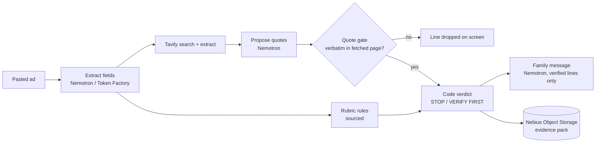

<div align="center">
  
  <h1>Awas 🚨</h1>
  <p><em>Paste an overseas job offer. Get an evidence file — every line a URL plus a quote that code checked against the page — and a STOP or VERIFY FIRST before anyone boards.</em></p>
  

  <br/>

  [](DEMO.md)
  [](FEEDBACK.md)
  [](https://nebiusglobalaihackathon.devpost.com/)

  <br/>

  
  
  
  
  
  
  [](https://opensource.org/licenses/MIT)

</div>

---

**Read first:** [`DEMO.md`](DEMO.md) (what was measured, and what was not) · [`FEEDBACK.md`](FEEDBACK.md) (feedback on the Nebius docs and API) · [`docs/SOURCES.md`](docs/SOURCES.md) (every rule and statistic, with the page and the verbatim sentence).

*Awas* is Indonesian for "watch out".

## 📸 See it in Action

**No credentials needed to read a case:** `/judge` and `/case/[id]` replay recorded evidence files without keys once samples are recorded (none are in the repo yet), and live checks need no login (60 per hour per IP). Run locally with the commands in [Getting Started](#-getting-started).

> **Status at this commit:** the app, gate, verdict and recorded-case replay are built and unit-tested; the deployed URL, recorded samples and screenshots are not yet in this repo. Nothing below is shown as a result until [`DEMO.md`](DEMO.md) holds it.

## 💡 The Problem & Solution

### The Problem

An aunt in a family WhatsApp group is forwarded an ad — "CS Kamboja, Rp 15 jt/bulan, visa turis OK, tiket ditanggung" — and must tell her nephew tonight whether to take it. Nobody in the group can tell her what has already been published about that company. (A composite scene, not a single person.)

The scale is official: Indonesia's foreign ministry reports **1,301 cases handled by the embassy in Cambodia in Q1 2025, 85 % of them online scams**, and **more than 12,000 Indonesians affected between 2021 and 2025**. Each statistic is quoted verbatim with its page in [`docs/SOURCES.md`](docs/SOURCES.md).

### The Solution

> The scam checkers we looked at give a risk score. Awas gives no score, only evidence: every quote has a URL and is checked in code against the page, and lines that fail are dropped on screen.

1. **Extract** — Nemotron on Nebius Token Factory pulls typed fields (company, destination, pay, fees, documents, contact) from the pasted Indonesian ad.
2. **Rubric** — fixed rules, each sourced to an official page or statute ([`src/lib/rule-sources.ts`](src/lib/rule-sources.ts)): tourist or visit visa for work, fee before a contract, passport held, and so on. Rules are classed `NEVER` or `CAUTION`.
3. **Search** — Tavily finds published pages that name this exact company or number, and recent reporting of the same pattern.
4. **Propose** — the model proposes evidence lines `{url, quote, claim}` over the pages Tavily returned in this run.
5. **Quote gate** — code accepts a quote only if it is a normalised verbatim substring of a chunk fetched in this run. A line that fails is dropped, visibly. Anyone can re-check with [`scripts/verify_quotes.py`](scripts/verify_quotes.py).
6. **Verdict by code, not by model** — **STOP**, **VERIFY FIRST**, or **NO RED FLAGS FOUND** (explicitly "not a guarantee"; never "safe"), from the rubric flags, the verified lines and any failed step ([`src/lib/verdict.ts`](src/lib/verdict.ts)).
7. **Family message** — a short Bahasa message built only from verified lines, with a link to the source of each.

## 🏗️ Architecture & Tech Stack



| Layer | Choice |
|---|---|
| App | Next.js 15, TypeScript, Tailwind 4 |
| Model | NVIDIA Nemotron 3 Super (`nvidia/nemotron-3-super-120b-a12b`) on Nebius Token Factory for all three calls; Nemotron Lightning was spiked (`scripts/spike.py`) and is selectable per call via `MODEL_CALL_n`, not used by default |
| Retrieval | Tavily `/search` and `/extract` |
| State | Nebius Object Storage (S3 API, SigV4): evidence packs (rewritten as each step completes), per-IP rate slots (conditional create); a 75-day expiry rule on `cases/` is intended, its receipt is pending |
| Nebius libraries | `src/lib/nebius/` (SigV4, Object Storage, service-account auth, Serverless Jobs), copied from the same author's earlier project, [faultline](https://github.com/edycutjong/faultline) |

## 🏆 Nebius Token Factory + NVIDIA Nemotron + Tavily Integration

| # | Sponsor method | What it does in the flow | Code |
|---|---|---|---|
| 1 | Nebius Token Factory `POST /v1/chat/completions`, Nemotron | up to three calls per case: extract fields; propose evidence lines; write the family message | [`tf.ts`](src/lib/tf.ts), [`extract.ts`](src/lib/extract.ts), [`propose.ts`](src/lib/propose.ts), [`message.ts`](src/lib/message.ts) |
| 2 | Tavily `POST /search` | exact-phrase search for the company and phone, news search for the pattern, page text for the gate | [`tavily.ts`](src/lib/tavily.ts) |
| 3 | Tavily `POST /extract` | relevant passages from official advisory pages | [`tavily.ts`](src/lib/tavily.ts) |
| 4 | Nebius Object Storage `PutObject` / `GetObject`; conditional `PutObject` for rate slots | evidence packs, per-IP rate slots | [`storage.ts`](src/lib/nebius/storage.ts), [`store.ts`](src/lib/store.ts) |

**Honest count: 4 distinct methods from 2 vendors**, with NVIDIA as the model family. A fifth (running the benchmark as a Nebius Serverless Job, [`jobs.ts`](src/lib/nebius/jobs.ts)) is counted only once its receipt exists; the client code is present, a run is not yet claimed.

The one extension no sponsor ships is the **quote gate**: two generic APIs become an evidence standard a reader can re-check. The model chooses where to look and what to quote; code decides what is shown.

## 📊 Engineering Rigor

| Metric | Value |
|---|---|
| Unit tests | **119 passing** (`npm test`, 10 files) |
| Browser tests | **36 passing** (`npm run e2e`: 18 checks × phone and desktop projects; credential-free paths only: home, `/judge`, `/integrations`, guards, no horizontal scroll at 375/768/1440 px) |
| Benchmark protocol | written before any row was collected: [`bench/PROTOCOL.md`](bench/PROTOCOL.md), with two dated amendments |
| Stage-T scoring rules | pre-registered before labels or model runs: [`bench/STAGE-T.md`](bench/STAGE-T.md) |
| Headline: scam ads stopped, company-matched (tranche 2, n/25) | **not yet measured** |
| Licensed (legitimate) ads wrongly stopped | **not yet measured** |
| False-stop distribution (licensed ads) | **not yet measured** |
| Ablation: full Awas vs code-only sentence picker vs no gate | **not yet measured** |
| Latency p50 / p95 to verdict | **not yet measured** |
| Cost per check / the bill | **not yet measured** |

These rows are filled from `bench/` receipts only. Until a row has a number, it has no number.

### Honest limits (5)

1. **Indonesian is not a listed language** for the Nemotron models used (per their model cards). Field accuracy on Indonesian ads is a measured number or it is not claimed.
2. **Stage-T labels** (the hand-labelled field truth the extraction is scored against) are drafted by an agent and unreviewed by a human; any figure scored against them is labelled so.
3. **The phone path is unbenchmarked.** A phone number with no company name returns VERIFY FIRST, not a verdict.
4. **Tavily's coverage of Indonesian sources is unmeasured**, and Tavily returns pages with publication dates that can leak into the search window.
5. **The licensed-ad set is plainer than social-media ads** (official vacancy-board listings), so reassurance wording is under-sampled.

Two outlets (antaranews.com, kompas.com) were removed from the benchmark before any model call because their terms prohibit AI use; see Amendment 2 in [`bench/PROTOCOL.md`](bench/PROTOCOL.md).

## 🚀 Getting Started

### Prerequisites

Node 20+, a Nebius Token Factory key, and a Tavily key (Tavily also documents keyless access for `/search` and `/extract`, free and rate-limited).

### Installation

```bash
npm ci
cp /dev/null .env.local   # then set the Token Factory key and project, Tavily key, and Object Storage credentials
npm run dev               # http://localhost:3000
```

## 🧪 Testing & CI

```bash
npm test          # 119 vitest tests: quote gate, verdict, rubric, masking, SigV4 vectors, clients, store, pipeline
npm run typecheck && npm run lint
npm run build && npm run e2e   # 36 Playwright tests, no credentials needed
```

`.github/workflows/ci.yml` runs lint, typecheck, unit tests, `npm audit`, a gitleaks scan of pushed commits (full history is scanned before the repo goes public), the production build and the browser tests. Dependabot (grouped, monthly) and CodeQL are configured; CodeQL needs the repository to be public. Details: [`CONTRIBUTING.md`](CONTRIBUTING.md), [`SECURITY.md`](SECURITY.md).

The quote gate is also checkable by hand: `python3 scripts/verify_quotes.py <case.json>`.

## 📁 Project Structure

```
src/lib/        gate.ts · verdict.ts · rubric.ts · pipeline.ts · tavily.ts · tf.ts · mask.ts · store.ts
src/lib/nebius/ SigV4, Object Storage, auth, Serverless Jobs
src/app/        paste screen, /judge, /case/[id], /integrations, /api/*
e2e/            Playwright specs (no credentials)
bench/          PROTOCOL.md · STAGE-T.md (pre-registered)
scripts/        bench.py · collect.py · stage_t.py · verify_quotes.py
docs/           SOURCES.md · assets/
```

## 🗺️ Roadmap

- [x] Core flow: extract → rubric → Tavily → quote gate → code verdict → family message
- [x] Evidence-file UI, recorded-case replay, `/judge`, `/integrations`
- [x] Benchmark and stage-T protocols written before data
- [ ] Frozen benchmark run and the numbers in [`DEMO.md`](DEMO.md)
- [ ] Recorded sample cases and screenshots of the live app
- [ ] Deployed URL, landing page, pitch deck, demo video

## 📄 License

MIT — see [`LICENSE`](LICENSE).

## 🙏 Acknowledgments

Rules and statistics come from Indonesia's foreign ministry, national police press office, manpower ministry and the statutes cited in [`docs/SOURCES.md`](docs/SOURCES.md). Shared Nebius client libraries are from the same author's faultline.
